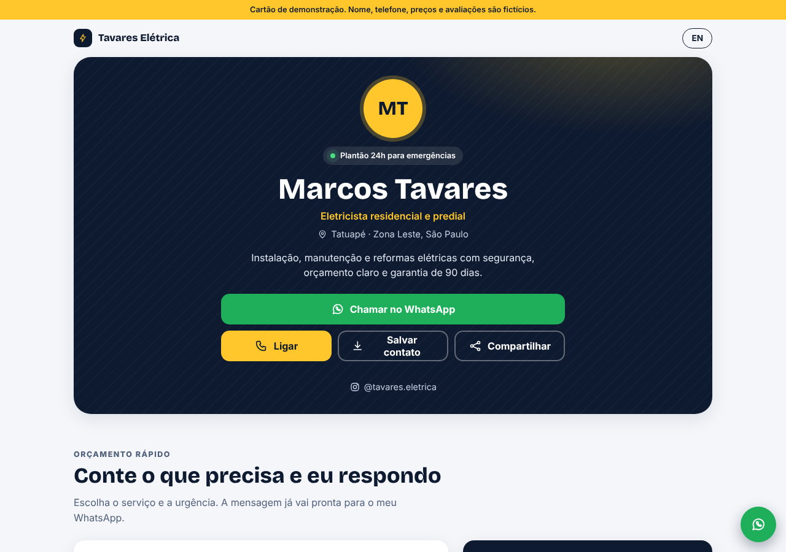
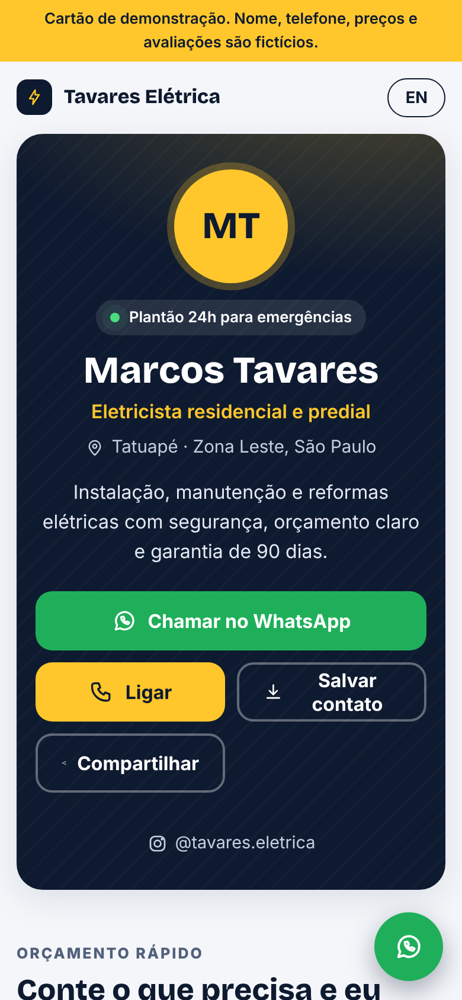

# Tavares Elétrica: cartão de visita digital (modelo)

Modelo de **cartão de visita digital** para profissional autônomo (aqui, um eletricista). Nome, telefone, preços e depoimentos são **fictícios**.





## O que tem

- **Ações rápidas**: chamar no WhatsApp (mensagem pronta), ligar, **salvar contato** (baixa um arquivo .vcf) e **compartilhar** (menu nativo do celular; no computador copia o link).
- **Orçamento rápido**: o cliente escolhe serviço, urgência e local; o valor da visita é calculado na hora e o pedido vai pronto para o WhatsApp. Mostra aviso de segurança em emergências.
- **QR code** gerado no próprio site, para imprimir em adesivo, cartão físico ou veículo.
- Serviços com preço "a partir de", garantia, depoimentos, bairros atendidos, horário e formas de pagamento.
- Bilíngue: português em `/` e inglês em `/en/`.
- Todo o conteúdo e os preços em um só arquivo: `src/data.js`.
- Pré-renderização estática, Open Graph, JSON-LD (`Electrician`) e `hreflang`/`canonical` (quando `site.url` estiver preenchido).
- Responsivo (360, 390 e 1280 px) e acessível: foco visível, "pular para o conteúdo", botões com `aria-pressed`, `prefers-reduced-motion` respeitado.

## Tecnologia

Vite 5 + React 18, `qrcode-generator`. Fontes Bricolage Grotesque e Inter hospedadas no próprio projeto (sem CDN).

## Como rodar

```bash
npm install
npm run dev       # desenvolvimento
npm run build     # build + pré-renderização em dist/
npm run preview   # servir o build
```

## Como adaptar para um cliente real

1. Troque textos, serviços e preços (`visitFee`, `urgencyFee`, `servicePrice`) em `src/data.js`. O nome do cliente aparece também em `site.person`, `site.brand`, `site.initials` e nos textos de `content`.
2. Troque `site.whatsapp`, `site.phone`, `site.phoneDisplay` (formato internacional, só dígitos) e `site.instagram`.
3. Preencha `site.url` com o endereço final e faça o redeploy. O QR code passa a apontar para ele (hoje usa `site.qrFallback`).
4. **Apague a linha `<meta name="robots" content="noindex, nofollow">`** em `index.html` (existe só porque os dados são fictícios).
5. Troque `public/og.png`, `public/og-en.png` (1200 x 630) e `public/favicon.svg`. Se quiser foto no lugar das iniciais, edite `.profile__avatar` em `src/App.jsx`.
6. Para outro nicho (barbeiro, manicure, advogado...), troque `serviceIds`/`content[lang].services` e `quote.services`, e o tipo em `src/entry-server.jsx` (`"@type": "Electrician"`).

## Observações

- O botão "Salvar contato" gera o vCard no navegador; nenhum dado é enviado a servidores.
- Compartilhar usa a Web Share API; onde não existe, copia o link para a área de transferência.
